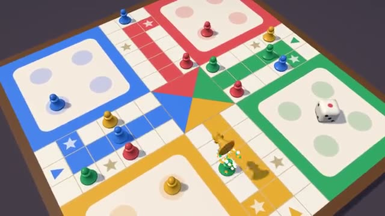

# Ludo Race

Roll, race your tokens home, knock rivals back. A multiplayer starter game from [Multiplayer Agent](https://multiplayeragent.com): 3D, turn-based, 2–4 players plus anyone who wants to watch, with bots that take every empty color.

## How it plays

Roll the die and hop a token that many squares round the board; a 6 brings a new token out of the yard. Land on a rival and it goes back to start. Get all four home first to win. A 6, a knock-back or a token getting home earns another roll. Bots play the empty colors, and a friend who joins takes over a bot's color mid-game.

**Controls:** Click or tap to roll, then click or tap a glowing token. Keys: Space to roll, 1–4 to pick a token.

## Make it yours in the Game Builder

Open the [Game Builder](https://multiplayeragent.com), choose **Start from a starter game** and pick Ludo Race. It opens as version 1 in your studio, ready to play and publish. Then ask for changes, for example:

- Add a boost square that jumps you 3 ahead
- Make the tokens little racing cars
- Let players chat with emoji during the game

## Run it yourself

1. Get a free publishable key (`pk_…`) at [multiplayeragent.com](https://multiplayeragent.com).
2. In `index.html`, put it in place of `pk_REPLACE_ME` in the `MP_CONNECT` block.
3. Serve the folder (for example `npx serve`) and open it. The 3D engine loads as a module, which browsers block from a file on disk.

Without a key it still runs, offline against the bots.

## How it is built

- One `index.html`, plus three.js in `libs/`. The comment at the top of the script maps the code and explains the multiplayer.
- **Host-run rules:** The host's browser rolls the die and checks every move; if it leaves, the next player takes over.
- **Bots:** Bots play every empty color, so you can play alone, and a friend who joins takes over a bot's color mid-game.
- **Live sync:** Everyone sees the same rolls and hops; the game carries on if someone reloads while another player stays.
- **Leaderboard:** Most wins, shown after every game.
- `?attract` runs it offline, four bots in a busy mid-game. The preview video is recorded from it.

## License

MIT.
